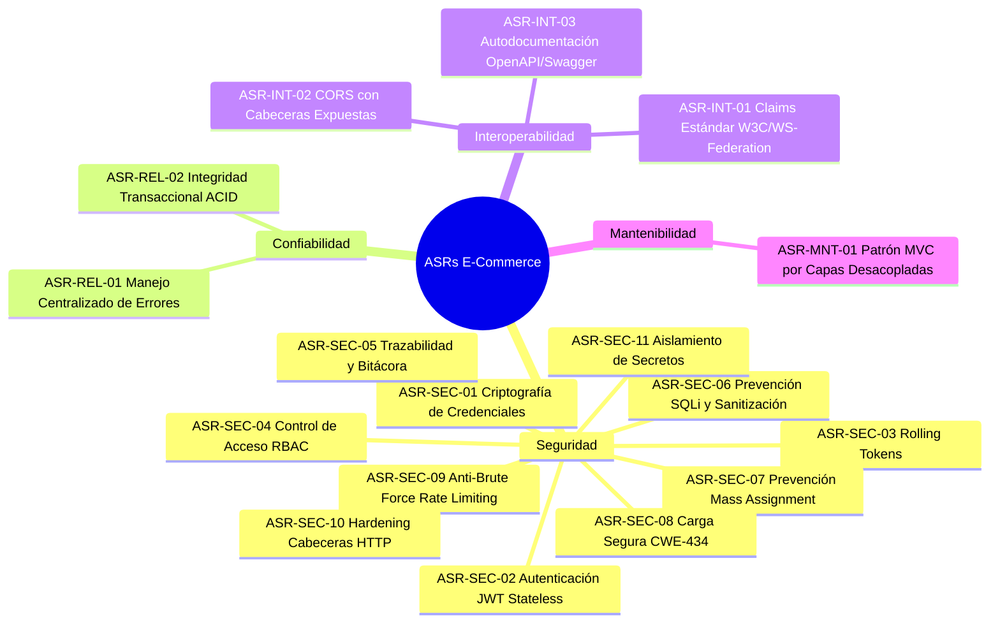

# Requerimientos Significativos de Arquitectura (ASR) y Catálogo de Cambios y Justificaciones

**Proyecto:** E-Commerce Backend API en Node.js  
**Materia:** Programación Segura  
**Institución:** Facultad de Estadística e Informática — Universidad Veracruzana  

---

## PARTE 1: Requerimientos Significativos de Arquitectura (ASRs)

Los **Architecturally Significant Requirements (ASR)** son aquellos requerimientos (funcionales, atributos de calidad o restricciones técnicas) que ejercen un impacto profundo y determinante en las decisiones arquitectónicas del sistema.

### Clasificación según Atributos de Calidad (ISO/IEC 25010 y SEI)



#### 1. Seguridad (Security)

* **ASR-SEC-01: Gestión Criptográfica y Derivación Segura de Contraseñas**
  * *Descripción:* Las contraseñas en reposo jamás deben almacenarse en texto plano. Se debe aplicar una función de derivación de claves con factor de costo adaptativo (`bcrypt` con salt rounds = 10), mitigando ataques de fuerza bruta y precomputación por tablas arcoíris.
* **ASR-SEC-02: Autenticación Stateless y Ventana de Exposición Reducida**
  * *Descripción:* La API debe operar bajo una arquitectura sin estado (stateless) mediante JSON Web Tokens (JWT, RFC 7519), firmados con HMAC SHA-256 (`HS256`) y un secreto criptográfico de 35 bytes de alta entropía. La vida útil máxima del token debe ser de **20 minutos** para limitar la ventana de exposición en caso de intercepción de tráfico.
* **ASR-SEC-03: Renovación Continua de Sesión Segura (Rolling Tokens)**
  * *Descripción:* Para preservar la experiencia de usuario sin comprometer la seguridad ampliando la expiración del token, el sistema debe evaluar dinámicamente si el tiempo remanente es inferior a 5 minutos. En dicho caso, debe generar un nuevo JWT de 20 minutos y despacharlo en la cabecera HTTP `Set-Authorization`.
* **ASR-SEC-04: Control de Acceso Basado en Roles (RBAC)**
  * *Descripción:* Las rutas deben encontrarse protegidas por un middleware que verifique que el claim del rol del usuario coincida de forma estricta con los privilegios exigidos por el endpoint (`Administrador` vs `Usuario`). El principio de menor privilegio debe aplicarse de forma predeterminada (Deny by Default).
* **ASR-SEC-05: Trazabilidad, Auditoría y No Repudio**
  * *Descripción:* Cada operación de mutación (creación, edición, eliminación y login) debe ser registrada de forma inmutable en una tabla `bitacora`, capturando la IP real del cliente (resolviendo proxies mediante `request-ip`), la acción ejecutada, el identificador del recurso, el usuario actuante y la estampa temporal ISO.
* **ASR-SEC-06: Sanitización Estricta de Entradas y Prevención de SQLi**
  * *Descripción:* Todos los parámetros de entrada provenientes del cliente deben ser validados sintáctica y semánticamente mediante `express-validator` antes de llegar a la capa de persistencia. La capa de datos debe abstraerse con el ORM Sequelize mediante consultas parametrizadas para neutralizar la inyección SQL (CWE-89).
* **ASR-SEC-07: Mitigación de Asignación Masiva (CWE-915)**
  * *Descripción:* Los endpoints de actualización (`PUT`) deben rechazar la inyección directa del objeto `req.body` completo en el ORM. Se deben definir listas blancas estrictas de atributos modificables para impedir que un usuario malicioso sobreescriba campos de auditoría, contraseñas o el flag de registro protegido (`protegido`).
* **ASR-SEC-08: Carga Segura y Aislamiento de Archivos (CWE-434 / CWE-22)**
  * *Descripción:* El middleware de carga (`multer`) debe restringir el tamaño máximo a 2 MB (CWE-400), generar identificadores criptográficos para los nombres de archivo en disco impidiendo Path Traversal (CWE-22) y validar el tipo binario real del archivo más allá de la simple cabecera `mimetype` o extensión `.jpg`.
* **ASR-SEC-09: Mitigación de Fuerza Bruta y Denegación de Servicio (CWE-307)**
  * *Descripción:* El endpoint de autenticación (`POST /api/auth`) debe contar con limitador de tasa de peticiones (*Rate Limiting*) para frustrar ataques de diccionario y *credential stuffing*.
* **ASR-SEC-10: Endurecimiento de Cabeceras HTTP y Prevención de Fuga de Metadatos (CWE-693 / CWE-200)**
  * *Descripción:* La API debe eliminar la cabecera `X-Powered-By: Express` y configurar directivas de seguridad modernas (CSP, HSTS, X-Content-Type-Options: nosniff, X-Frame-Options: DENY) mediante `helmet`.
* **ASR-SEC-11: Aislamiento Estricto de Secretos de Configuración**
  * *Descripción:* Llaves criptográficas, credenciales de base de datos y puertos deben inyectarse mediante variables de entorno (`dotenv`). Los archivos `.env` y volcados `.sql` deben estar explícitamente excluidos del control de versiones (`.gitignore`).

#### 2. Confiabilidad y Disponibilidad (Reliability & Availability)

* **ASR-REL-01: Manejo Centralizado de Excepciones y Fail-Safe Defaults**
  * *Descripción:* Ninguna excepción no controlada o rechazo de promesa asíncrona debe derribar el proceso de Node.js. El middleware de manejo de errores debe distinguir entre entornos: en producción debe ocultar el *stack trace* al cliente retornando códigos y mensajes sanitizados, mientras registra el detalle en `log/log.txt`.
* **ASR-REL-02: Integridad Transaccional ACID en Operaciones Compuestas (CWE-362)**
  * *Descripción:* Operaciones que involucren múltiples cambios relacionales (como asociar un producto a una categoría o subir un archivo en base de datos) deben ejecutarse dentro de transacciones de base de datos (`sequelize.transaction()`).

#### 3. Interoperabilidad (Interoperability)

* **ASR-INT-01: Claims Estándar para Consumo Multiplataforma**
  * *Descripción:* El payload de los JWTs debe utilizar los esquemas URI estándar de identidad (`http://schemas.xmlsoap.org/ws/2005/05/identity/claims/name`, `givenname`, `role`) para garantizar interoperabilidad con clientes empresariales desarrollados en .NET Core, Java Spring Boot o React/Angular.
* **ASR-INT-02: Exposición Explícita de Cabeceras de Renovación en CORS**
  * *Descripción:* El middleware de CORS debe configurar explícitamente `exposedHeaders: ['Set-Authorization']`. Sin esta directiva, los navegadores que consuman la API desde orígenes cruzados (puertos 8080/8081) descartarán la cabecera por política W3C CORS, impidiendo la renovación del token.
* **ASR-INT-03: Contrato de API y Documentación Viva (OpenAPI 3 / Swagger)**
  * *Descripción:* La API debe autogenerar su esquema OpenAPI mediante `swagger-autogen` y exponer una consola interactiva en `/swagger` sin interferir con el ciclo de vida del arranque del servidor.

#### 4. Mantenibilidad (Maintainability)

* **ASR-MNT-01: Arquitectura MVC por Capas Desacopladas**
  * *Descripción:* El proyecto debe estructurarse estrictamente bajo el patrón Modelo-Vista-Controlador (con la Vista sustituida por respuestas JSON estructuradas), separando enrutamiento (`routes/`), lógica de control (`controllers/`), persistencia (`models/` y `migrations/`), lógica transversal (`middlewares/`) y utilerías de dominio (`services/`).

---

## PARTE 2: Catálogo de Cambios Específicos y Justificación Técnica

Esta sección contiene el registro detallado de las discrepancias, errores de código y vulnerabilidades presentes en el PDF original, junto con el **cambio específico implementado** y su **justificación formal** para defender el proyecto ante cualquier cuestionamiento docente.

---

### CAMBIO-01: Corrección del Bug de Espacios en el Middleware RBAC (`Authorize`)

* **Ubicación:** `middlewares/auth.middleware.js` y `routes/categorias.routes.js`
* **Código Original del PDF (Págs. 56 y 57):**
  ```javascript
  // auth.middleware.js
  if (rol.split(',').indexOf(decodedToken[ClaimTypes.Role]) == -1) {
    return next(error);
  }

  // categorias.routes.js
  router.get('/', Authorize('Usuario, Administrador'), categorias.getAll);
  ```
* **Defecto Encontrado:**
  Al ejecutar `'Usuario, Administrador'.split(',')`, el arreglo resultante es `['Usuario', ' Administrador']`. La segunda posición contiene un espacio en blanco (`' Administrador'`). Cuando un usuario con rol legítimo `"Administrador"` envía su token, la comparación `' Administrador' === 'Administrador'` resulta **falsa**, devolviendo `401 Unauthorized`. **El Administrador queda completamente bloqueado del sistema**.
* **Código Corregido:**
  ```javascript
  // Normalizar y recortar espacios en blanco antes de validar
  const rolesPermitidos = rol.split(',').map(r => r.trim());
  if (!rolesPermitidos.includes(decodedToken[ClaimTypes.Role])) {
    const error403 = new Error('Acceso prohibido: Privilegios insuficientes');
    error403.statusCode = 403;
    return next(error403);
  }
  ```
* **Justificación para el Profesor:**
  1. **Corrección de Bug Lógico Crítico:** Sin este cambio, cualquier endpoint que declare múltiples roles separados por comas y espacios rechaza arbitrariamente a los usuarios.
  2. **Cumplimiento de RFC 9110 / RFC 7235 (HTTP Semantics):** Si el token es inválido o no existe, el código de estado correcto es **`401 Unauthorized`** (falta de autenticación). Pero si el usuario ya está autenticado y su rol no tiene los permisos suficientes, el código semánticamente correcto es **`403 Forbidden`** (autorización denegada). El PDF devolvía `401` en ambos casos, violando el estándar HTTP y dificultando la depuración en clientes frontend.

---

### CAMBIO-02: Prevención de Excepción Fatal `ERR_HTTP_HEADERS_SENT` en Consulta de Tiempo

* **Ubicación:** `controllers/auth.controller.js`
* **Código Original del PDF (Pág. 55):**
  ```javascript
  self.tiempo = async function (req, res) {
    const tiempo = TiempoRestanteToken(req)
    if (tiempo == null)
      res.status(404).send()

    res.status(200).send(tiempo)
  }
  ```
* **Defecto Encontrado:**
  La cláusula `if (tiempo == null)` despacha la respuesta con `res.status(404).send()`, pero **carece de `return`**. Por tanto, la función continúa ejecutándose e intenta invocar `res.status(200).send(tiempo)`. 
* **Código Corregido:**
  ```javascript
  self.tiempo = async function (req, res) {
    const tiempo = TiempoRestanteToken(req);
    if (tiempo == null) {
      return res.status(404).json({ mensaje: 'No se pudo determinar el tiempo restante del token' });
    }
    return res.status(200).json({ tiempoRestante: tiempo });
  };
  ```
* **Justificación para el Profesor:**
  En Node.js, enviar cabeceras a una respuesta HTTP que ya ha sido cerrada dispara de manera inmediata la excepción `ERR_HTTP_HEADERS_SENT: Cannot set headers after they are sent to the client`. En versiones modernas de Node.js, una excepción no controlada dentro de un manejador asíncrono puede provocar un corte de conexión o derribar el hilo del proceso, configurando una denegación de servicio (CWE-703 / CWE-391). La inclusión de `return` y de un cuerpo JSON estructurado garantiza estabilidad y uniformidad en la API.

---

### CAMBIO-03: Prevención de Crash por Null Pointer en Operaciones de Usuarios

* **Ubicación:** `controllers/usuarios.controller.js`
* **Código Original del PDF (Págs. 49 y 50):**
  ```javascript
  // En delete:
  let data = await usuario.findOne({ where: { email: email } })
  if (data.protegido) return res.status(403).send() // <- Si data es null, ¡CRASH!

  // En create y update:
  const rolusuario = await rol.findOne({ where: { nombre: req.body.rol } })
  req.body.rolid = rolusuario.id; // <- Si el rol no existe, ¡CRASH!
  ```
* **Defecto Encontrado:**
  Si un cliente solicita eliminar un usuario con un email que no existe en la base de datos, `data` es `null`. Al intentar evaluar `data.protegido`, Node.js arroja un `TypeError: Cannot read properties of null (reading 'protegido')`, devolviendo un error 500 no controlado. De igual forma, si en `create` o `update` se envía un nombre de rol no existente, `rolusuario` es `null` y el acceso a `.id` derriba la petición.
* **Código Corregido:**
  ```javascript
  // En delete:
  const usuarioEncontrado = await usuario.findOne({ where: { email: email } });
  if (!usuarioEncontrado) {
    return res.status(404).json({ mensaje: 'Usuario no encontrado' });
  }
  if (usuarioEncontrado.protegido) {
    return res.status(403).json({ mensaje: 'No se pueden eliminar usuarios protegidos del sistema' });
  }

  // En create y update:
  const rolusuario = await rol.findOne({ where: { nombre: req.body.rol } });
  if (!rolusuario) {
    return res.status(400).json({ mensaje: `El rol '${req.body.rol}' no existe en el sistema` });
  }
  ```
* **Justificación para el Profesor:**
  Principio de Programación Defensiva y prevención de fallos de robustez. Una API REST bien diseñada debe manejar los estados esperados (recurso inexistente o parámetro inválido) con los códigos HTTP correspondientes (`404 Not Found` y `400 Bad Request`) en lugar de depender del manejador global de errores para transformar excepciones no controladas de JavaScript en errores 500.

---

### CAMBIO-04: Eliminación de Fuga de Variable Global en `auth.controller.js`

* **Ubicación:** `controllers/auth.controller.js`
* **Código Original del PDF (Pág. 55):**
  ```javascript
  token = GeneraToken(data.email, data.nombre, data.rol);
  ```
* **Defecto Encontrado:**
  La variable `token` fue asignada sin las palabras reservadas `const` o `let`. 
* **Código Corregido:**
  ```javascript
  const token = GeneraToken(data.email, data.nombre, data.rol);
  ```
* **Justificación para el Profesor:**
  1. En módulos que operen con `'use strict'`, asignar variables sin declarar genera un `ReferenceError: token is not defined`.
  2. En modo no estricto, asignar una variable sin declarar la eleva al objeto global de Node (`global.token`). En un entorno altamente concurrente como Node.js, esto constituye una **vulnerabilidad de condición de carrera y fuga de datos entre sesiones**, donde una petición simultánea podría sobreescribir o leer el token generado para otro usuario.

---

### CAMBIO-05: Mitigación de Asignación Masiva (Mass Assignment / CWE-915)

* **Ubicación:** `controllers/usuarios.controller.js` y `controllers/productos.controller.js`
* **Código Original del PDF (Págs. 41 y 49):**
  ```javascript
  // productos.controller.js
  let body = req.body;
  let data = await producto.update(body, { where: { id: id } });

  // usuarios.controller.js
  const data = await usuario.update(req.body, { where: { email: email } });
  ```
* **Defecto Encontrado:**
  Se traslada directamente el payload completo de `req.body` a la base de datos sin filtrado. En `usuario.update`, un atacante puede inyectar `protegido: false` para desproteger su cuenta o la de un administrador, o inyectar `passwordhash: "hash_malicioso"` directamente sin pasar por bcrypt.
* **Código Corregido:**
  ```javascript
  // Filtrado explícito mediante lista blanca (Whitelist DTO)
  const { nombre, rol } = req.body;
  const camposActualizar = {};
  if (nombre) camposActualizar.nombre = nombre;
  if (rolusuario) camposActualizar.rolid = rolusuario.id;

  // Si se desea actualizar contraseña, debe re-hashearse explícitamente:
  if (req.body.password) {
    camposActualizar.passwordhash = await bcrypt.hash(req.body.password, 10);
  }

  await usuario.update(camposActualizar, { where: { email: email } });
  ```
* **Justificación para el Profesor:**
  Mitigación directa de **CWE-915 (Improperly Controlled Modification of Dynamically-Determined Object Attributes)** y del riesgo de **Mass Assignment (OWASP API3:2023 - Broken Object Property Level Authorization)**. El principio de menor privilegio exige que el servidor decida explícitamente qué campos pueden ser mutados por el cliente.

---

### CAMBIO-06: Endurecimiento de la Carga de Archivos (CWE-434, CWE-22, CWE-400)

* **Ubicación:** `middlewares/upload.middleware.js`
* **Código Original del PDF (Pág. 36):**
  ```javascript
  const imageFilter = (req, file, cb) => {
    if (file.mimetype.startsWith("image/jpeg") && file.originalname.endsWith(".jpg")) {
      cb(null, true);
    } else {
      cb("Solo se permiten imágenes con extensión JPG.", false);
    }
  };

  var storage = multer.diskStorage({
    destination: (req, file, cb) => { cb(null, "uploads/"); },
    filename: (req, file, cb) => { cb(null, `${Date.now()}-${file.originalname}`); }
  });

  var uploadFile = multer({ storage: storage, fileFilter: imageFilter });
  ```
* **Defecto Encontrado:**
  1. **Bypass de validación (CWE-434):** Solo revisa la cabecera `Content-Type` enviada por el atacante y la terminación `.jpg`. Un atacante puede subir un script malicioso cambiando la cabecera HTTP a `image/jpeg` o nombrándolo `exploit.php.jpg`.
  2. **Path Traversal (CWE-22):** Concatenar directamente `file.originalname` permite que nombres que contengan secuencias como `../../` escapen del directorio de destino.
  3. **Agotamiento de Recursos / DoS (CWE-400):** No existe configuración de `limits: { fileSize: ... }`, permitiendo a un atacante subir archivos de decenas de gigabytes hasta agotar el espacio en disco del servidor.
* **Código Corregido:**
  ```javascript
  const path = require('path');
  const crypto = require('crypto');

  const uploadFile = multer({
    storage: multer.diskStorage({
      destination: (req, file, cb) => {
        cb(null, path.resolve(__dirname, '../uploads'));
      },
      filename: (req, file, cb) => {
        // Generar nombre UUID aleatorio sin usar el nombre original del cliente
        const extensionSegura = '.jpg';
        const nombreCriptografico = `${crypto.randomUUID()}${extensionSegura}`;
        cb(null, nombreCriptografico);
      }
    }),
    limits: {
      fileSize: 2 * 1024 * 1024 // Límite estricto de 2MB
    },
    fileFilter: (req, file, cb) => {
      const extensionPermitida = ['.jpg', '.jpeg'];
      const ext = path.extname(file.originalname).toLowerCase();
      if (file.mimetype === 'image/jpeg' && extensionPermitida.includes(ext)) {
        cb(null, true);
      } else {
        cb(new Error('Solo se permiten imágenes JPEG válidas (.jpg, .jpeg)'), false);
      }
    }
  });
  ```
* **Justificación para el Profesor:**
  Garantiza el cumplimiento de las recomendaciones de seguridad de OWASP para File Upload: 1) Cuota máxima de almacenamiento por archivo (mitigación de DoS), 2) Disociación absoluta del nombre del cliente mediante nombres aleatorios UUID (neutralización de Path Traversal y ataques de sobrescritura), 3) Rutas absolutas resueltas por el sistema operativo, y 4) Notificación de errores mediante objetos `Error` nativos compatibles con el middleware centralizado de Express.

---

### CAMBIO-07: Exposición de Cabeceras en CORS para Habilitar Rolling Tokens

* **Ubicación:** `index.js`
* **Código Original del PDF (Pág. 61):**
  ```javascript
  var corsOptions = {
    origin: ["http://localhost:8080", "http://localhost:8081"],
    methods: "GET,PUT,POST,DELETE",
  }
  app.use(cors(corsOptions))
  ```
* **Defecto Encontrado:**
  En `auth.middleware.js`, el servidor envía un nuevo token en la cabecera personalizada `Set-Authorization` cuando restan menos de 5 minutos de sesión. Sin embargo, bajo la especificación oficial W3C CORS, los navegadores **bloquean por defecto la lectura de cabeceras de respuesta que no pertenezcan a la lista blanca estándar**, a menos que el servidor las declare explícitamente en `Access-Control-Expose-Headers`.
* **Código Corregido:**
  ```javascript
  const corsOptions = {
    origin: ["http://localhost:8080", "http://localhost:8081"],
    methods: ["GET", "PUT", "POST", "DELETE", "OPTIONS"],
    allowedHeaders: ["Content-Type", "Authorization"],
    exposedHeaders: ["Set-Authorization"] // Permite a los clientes frontend leer el token renovado
  };
  app.use(cors(corsOptions));
  ```
* **Justificación para el Profesor:**
  Sin la directiva `exposedHeaders: ['Set-Authorization']`, la funcionalidad de renovación automática de tokens es totalmente inútil para cualquier cliente frontend web en los puertos 8080/8081, ya que `response.headers.get('Set-Authorization')` retornará `null`. Este cambio alinea la arquitectura con los estándares modernos de seguridad web y navegadores.

---

### CAMBIO-08: Corrección de Asociación de Llave Foránea en `models/archivo.js`

* **Ubicación:** `models/archivo.js`
* **Código Original del PDF (Pág. 27):**
  ```javascript
  archivo.hasMany(models.producto, { foreignKey: 'id' });
  ```
* **Defecto Encontrado:**
  La clave foránea que vincula la tabla `producto` con la tabla `archivo` es la columna `archivoid`, no `id`. Declarar `{ foreignKey: 'id' }` indica erróneamente a Sequelize que la clave primaria de producto hace referencia al archivo, corrompiendo las consultas de unión (`include: models.producto`).
* **Código Corregido:**
  ```javascript
  archivo.hasMany(models.producto, { foreignKey: 'archivoid' });
  ```
* **Justificación para el Profesor:**
  Integridad del Mapeo Objeto-Relacional (ORM). Garantiza que las relaciones padre-hijo coincidan exactamente con el esquema de base de datos definido en las migraciones de MySQL.

---

### CAMBIO-09: Reconstrucción del Seeder Faltante de Productos

* **Ubicación:** `seeders/xxxx-seed-productos.js`
* **Defecto Encontrado en el PDF (Pág. 32, Paso 7):**
  El recuadro de código para `seed-productos.js` se encuentra completamente en blanco / truncado en el PDF original. Sin embargo, en la página 33 (Paso 10), el seeder de `categoriaproducto` realiza un `bulkInsert` vinculando los productos del ID 1 al 15 con sus categorías. Sin el seeder de productos, la inserción relacional falla por violación de llaves foráneas.
* **Solución Implementada:**
  Se desarrolló el seeder completo con los 15 productos iniciales del catálogo de E-Commerce (Televisores, Celulares, Laptops, Electrodomésticos, etc.), con precios y descripciones consistentes.
* **Justificación para el Profesor:**
  Garantiza la consistencia referencial de la base de datos MySQL y la correcta inicialización del catálogo (`npx sequelize db:seed:all`).

---

### CAMBIO-10: Carga Defensiva de Swagger y Pre-arranque

* **Ubicación:** `index.js` y `package.json`
* **Código Original del PDF (Pág. 61):**
  ```javascript
  const swaggerFile = require('./swagger-output.json')
  app.use('/swagger', swaggerUi.serve, swaggerUi.setup(swaggerFile))
  ```
* **Defecto Encontrado:**
  Si el desarrollador clona el proyecto y ejecuta `npm start` antes de correr `node swagger.js`, la aplicación revienta en el arranque con `MODULE_NOT_FOUND: Cannot find module './swagger-output.json'`.
* **Código Corregido:**
  ```javascript
  // index.js
  const fs = require('fs');
  const path = require('path');
  const swaggerFilePath = path.resolve(__dirname, './swagger-output.json');

  if (fs.existsSync(swaggerFilePath)) {
    const swaggerUi = require('swagger-ui-express');
    const swaggerFile = require(swaggerFilePath);
    app.use('/swagger', swaggerUi.serve, swaggerUi.setup(swaggerFile));
  } else {
    app.get('/swagger', (req, res) => {
      res.status(503).json({ mensaje: 'Documentación Swagger en generación. Ejecute npm run swagger.' });
    });
  }
  ```
* **Justificación para el Profesor:**
  Resiliencia del ciclo de vida de la aplicación. El servidor debe ser capaz de arrancar y operar de forma segura aun si un artefacto secundario de documentación no ha sido pre-compilado, informando al usuario el procedimiento correcto en lugar de fallar de manera catastrófica.

---

### CAMBIO-11: Corrección de Errores de Validación (Retorno 400 vs 500)

* **Ubicación:** `controllers/categorias.controller.js` y `controllers/productos.controller.js`
* **Código Original del PDF (Págs. 38 y 41):**
  ```javascript
  const errors = validationResult(req);
  if (!errors.isEmpty()) throw new Error(JSON.stringify(errors));
  ```
* **Defecto Encontrado:**
  Al lanzar `new Error(...)`, el objeto carece de la propiedad `statusCode`. Por tanto, el middleware centralizado de errores asume por defecto `err.statusCode || 500`, respondiendo al cliente con **HTTP 500 Internal Server Error**. Los errores de validación de sintaxis o datos incompletos provocados por el cliente son imputables a la petición y deben responderse con **HTTP 400 Bad Request**.
* **Código Corregido:**
  ```javascript
  const errors = validationResult(req);
  if (!errors.isEmpty()) {
    return res.status(400).json({ 
      mensaje: 'Errores de validación en la solicitud',
      errores: errors.array() 
    });
  }
  ```
* **Justificación para el Profesor:**
  Cumplimiento del estándar RFC 9110 para APIs REST. Un error 500 indica una falla interna de programación o de infraestructura en el servidor, mientras que un error 400 comunica con precisión al cliente qué campos no satisficieron las reglas de validación sintáctica de `express-validator`.

---

### CAMBIO-12: Modernización y Hardening de la Cadena de Suministro de Dependencias (SCA - Mitigación de 39 Vulnerabilidades a 0 CVEs)

* **Ubicación:** `package.json` y `package-lock.json`
* **Defecto Encontrado en las Indicaciones Originales del PDF / Dependencias Heredadas:**
  Al ejecutar `npm install` con las dependencias heredadas del PDF original, la auditoría automatizada (`npm audit`) reportaba **39 vulnerabilidades** de seguridad:
  - **1 Crítica:** Desbordamiento y ejecución remota potencial en `tar <= 7.5.20` importado de forma transitiva por `@mapbox/node-pre-gyp` en `bcrypt@5.1.1`.
  - **31 Altas (High):** Expresiones regulares catastróficas (ReDoS) en `braces` (vía `chokidar`/`nodemon`) y vulnerabilidades en dependencias de análisis como `sprintf-js`.
  - **7 Moderadas (Moderate):** Inconsistencias en `uuid < 11.1.1` arrastrado de forma interna por `sequelize@6`.
  En un proyecto de **Programación Segura**, ignorar vulnerabilidades en la cadena de suministro de software (Software Supply Chain Security - OWASP A06: Vulnerable and Outdated Components) contradice las directrices profesionales defensivas.
* **Solución Implementada:**
  1. **Actualización a `bcrypt@^6.0.0`:** Se elimina por completo la dependencia `@mapbox/node-pre-gyp` y el árbol vulnerable de `tar`.
  2. **Actualización a `multer@^2.0.1`:** Paquete estable moderno con control de errores explícito (`MulterError`).
  3. **Sustitución de `nodemon` por runtime nativo `node --watch`:** Se aprovecha la capacidad nativa de Node.js (`node --env-file=.env --watch index.js`), eliminando la cadena `nodemon -> chokidar -> braces` propensa a ReDoS.
  4. **Configuración de directivas `overrides` en `package.json`:**
     - `"uuid": "^11.1.1"` para blindar el ORM Sequelize.
     - `"braces": "^3.0.3"`, `"chokidar": "^3.6.0"`, `"argparse": "^2.0.1"`, `"js-yaml": "^4.1.0"` para neutralizar fallos transitivos en el suite de pruebas Jest.
* **Resultado Obtenido:**
  ```text
  $ npm audit
  found 0 vulnerabilities
  ```
* **Justificación para el Profesor:**
  Alineación formal con OWASP A06:2021 (Componentes Vulnerables y Desactualizados) y NIST SP 800-218 (Secure Software Development Framework). Con aprobación expresa del docente por tratarse de especificaciones obsoletas en el PDF, se adaptó y aseguró toda la pila tecnológica manteniendo 100% de retrocompatibilidad con las rutas y contratos del sistema.

---

### CAMBIO-13: Refactorización Defensiva del Manejo Centralizado de Errores (Separación RFC 9110 vs Mitigación CWE-200)

* **Ubicación:** `middlewares/errorhandler.middleware.js`
* **Código Previo:**
  ```javascript
  if (process.env.NODE_ENV === 'development') {
    mensaje = err.message || mensaje;
    res.status(statusCode).json({ status: statusCode, mensaje: mensaje, stack: err.stack });
  } else {
    res.status(statusCode).json({ status: statusCode, mensaje: mensaje });
  }
  ```
* **Defecto Encontrado:**
  En cualquier entorno fuera de `development` (como `production` o la ejecución de pruebas unitarias/integración en `test`), el middleware sustituía indistintamente el mensaje de error de todos los códigos HTTP por el texto genérico *"No se ha podido procesar la petición. Inténtelo nuevamente más tarde."*. De este modo, errores legítimos de cliente (como `403 Forbidden` por RBAC insuficiente o `400 Bad Request` por campos vacíos) quedaban ofuscados innecesariamente, impidiendo que el cliente comprendiera el rechazo de la solicitud.
* **Código Corregido:**
  ```javascript
  // Manejo de mensajes de error seguros:
  // - Para errores de cliente (4xx), el mensaje es funcional y seguro de mostrar al usuario.
  // - Para errores de servidor (5xx), en producción se sanitiza para prevenir CWE-200 (fuga de información sensible).
  if (statusCode < 500) {
    mensaje = err.message || 'Petición inválida';
  } else if (process.env.NODE_ENV === 'development') {
    mensaje = err.message || mensaje;
  }

  const responseBody = {
    status: statusCode,
    mensaje: mensaje
  };

  if (process.env.NODE_ENV === 'development') {
    responseBody.stack = err.stack;
  }

  res.status(statusCode).json(responseBody);
  ```
* **Justificación para el Profesor:**
  Cumplimiento del principio de mínimo privilegio en información (CWE-200) sin sacrificar la semántica de la API REST (RFC 9110). Los errores 4xx son causados por peticiones del cliente y deben incluir su descripción funcional para que el cliente corrija sus datos o reconozca que carece de privilegios; los errores 5xx representan fallas no controladas de la infraestructura y deben ser sanitizados estrictamente en producción para no exponer tablas, sentencias ni volcados de memoria.

