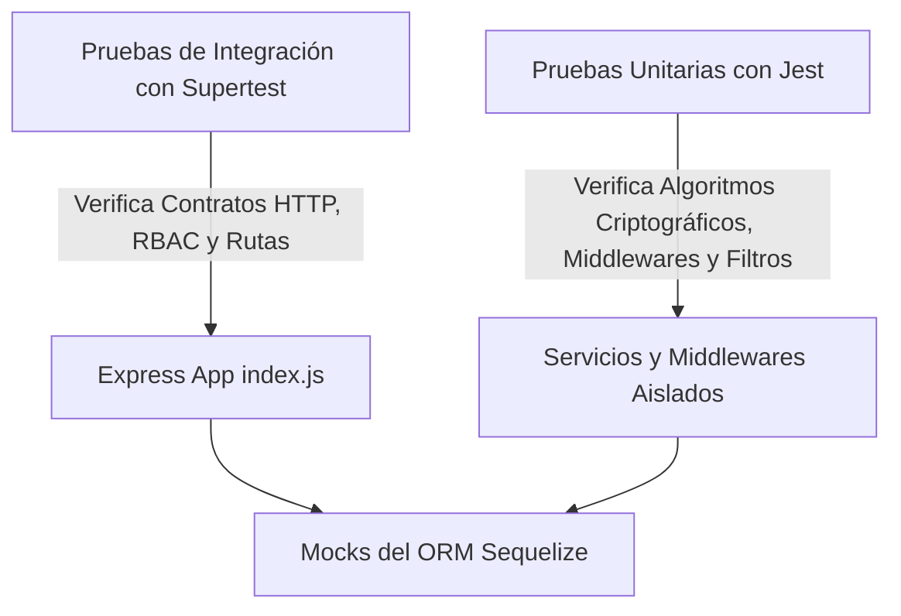

# Plan y Reporte de Pruebas Unitarias y de Integración 🧪

**Proyecto:** E-Commerce Backend API en Node.js  
**Materia:** Programación Segura  
**Institución:** Facultad de Estadística e Informática — Universidad Veracruzana  
**Herramientas de Prueba:** Jest (v30.x), Supertest (v7.x), Bcrypt (v6.x), Multer (v2.x)  

---

## PARTE 1: Plan de Pruebas (Test Plan)

### 1.1 Objetivo del Plan de Pruebas
Garantizar que el sistema backend de E-Commerce no solo satisfaga los requerimientos funcionales estipulados en la práctica guiada, sino que cumpla de forma verificable con los **estándares de Programación Segura**, validando la neutralización de los vectores de ataque identificados (OWASP API Security Top 10 y debilidades CWE/SANS Top 25).

### 1.2 Estrategia de Pruebas y Pirámide de Aislamiento
El aseguramiento de calidad se estructura en dos niveles:



1. **Pruebas Unitarias (Unit Testing):**
   - **Propósito:** Evaluar funciones y middlewares de forma completamente aislada, verificando su comportamiento ante entradas maliciosas o bordes.
   - **Aislamiento:** No requieren conexión a una base de datos MySQL activa; operan en memoria a máxima velocidad.
2. **Pruebas de Integración (Integration Testing):**
   - **Propósito:** Validar el flujo HTTP de extremo a extremo a través de la aplicación Express mediante `supertest`.
   - **Cobertura:** Verificación de serialización JSON, códigos de estado HTTP (200, 201, 204, 400, 401, 403, 404, 409), cabeceras de seguridad y guardas de autorización RBAC.

---

### 1.3 Matriz de Casos de Prueba

| ID | Nivel | Componente | Escenario de Prueba | Resultado Esperado | Vector CWE / OWASP Asociado |
| :--- | :--- | :--- | :--- | :--- | :--- |
| **CP-UNI-01** | Unitaria | `jwttoken.service` | Generación de token JWT con claims estándar | Estructura válida de 3 segmentos con claims de nombre, email y rol | **ASR-SEC-02** / RFC 7519 |
| **CP-UNI-02** | Unitaria | `jwttoken.service` | Ventana de expiración efímera | Expiración fijada exactamente en 20 minutos (1200 seg) | **ASR-SEC-02** / Ventana de exposición |
| **CP-UNI-03** | Unitaria | `jwttoken.service` | Cálculo de tiempo restante de sesión | Formato `00:MM:SS` exacto; `null` ante manipulaciones | **ASR-SEC-03** |
| **CP-UNI-04** | Unitaria | `auth.middleware` | Petición sin cabecera `Authorization` | Rechazo con código `401 Unauthorized` | **OWASP API2:2023** (Broken Authentication) |
| **CP-UNI-05** | Unitaria | `auth.middleware` | **Corrección de Bug:** RBAC con espacios (`Usuario, Administrador`) | Autorización exitosa para usuario con rol `Administrador` | **OWASP API1:2023** (Broken Object Level Authorization) |
| **CP-UNI-06** | Unitaria | `auth.middleware` | Usuario autenticado accediendo a ruta exclusiva de Admin | Rechazo con código `403 Forbidden` | **RFC 9110** / Control de Acceso RBAC |
| **CP-UNI-07** | Unitaria | `auth.middleware` | Renovación continua con tiempo restante < 5 min | Inyección del nuevo token en cabecera `Set-Authorization` | **ASR-SEC-03** (Rolling Tokens) |
| **CP-UNI-08** | Unitaria | `upload.middleware` | Cuota de tamaño de archivos | Límite forzado a 2 MB (2097152 bytes) | **CWE-400** (Resource Exhaustion / DoS) |
| **CP-UNI-09** | Unitaria | `upload.middleware` | Subida de scripts con doble extensión (`shell.php.jpg`) | Rechazo con código `400 Bad Request` | **CWE-434** (Unrestricted Upload) |
| **CP-UNI-10** | Unitaria | `upload.middleware` | Subida con secuencias de escape (`../../etc/passwd`) | Nombre sanitizado aleatoriamente sin secuencias `..` | **CWE-22** (Path Traversal) |
| **CP-UNI-11** | Unitaria | `errorhandler.middleware`| Ocultación de stack traces en entorno de producción | Respuestas sin campo `stack` y con mensaje sanitizado | **CWE-200** (Information Exposure) |
| **CP-INT-01** | Integración | `security_headers` | Verificación de cabeceras de servidor | Cabecera `X-Powered-By: Express` completamente suprimida | **CWE-200** / Fingerprinting |
| **CP-INT-02** | Integración | `security_headers` | Peticiones OPTIONS con política CORS | Inclusión de `Access-Control-Expose-Headers: Set-Authorization` | **ASR-INT-02** / W3C CORS |
| **CP-INT-03** | Integración | `auth.routes` | Login con credenciales incompletas | Respuesta `400 Bad Request` indicando campos requeridos | **RFC 9110** |
| **CP-INT-04** | Integración | `auth.routes` | Login con usuario inexistente / contraseña errónea | Respuesta `401 Unauthorized` uniforme sin filtrar existencia | **CWE-208** (Observable Timing Discrepancy) |
| **CP-INT-05** | Integración | `categorias.routes` | Intento de eliminación de categoría protegida | Respuesta `400 Bad Request` prohibiendo la operación | Regla de Integridad de Catálogo |
| **CP-INT-06** | Integración | `usuarios.routes` | Creación de usuario asignando un rol no existente | Respuesta `400 Bad Request` (evita Null Pointer DoS) | **CWE-703** (Improper Handling of Exceptional Conditions) |
| **CP-INT-07** | Integración | `usuarios.routes` | Eliminación de usuario con correo inexistente | Respuesta `404 Not Found` (evita Null Pointer DoS) | **CWE-703** / Robustez |
| **CP-INT-08** | Integración | `usuarios.routes` | Intento de eliminación del usuario raíz protegido | Respuesta `403 Forbidden` | Integridad de Cuentas del Sistema |

---

## PARTE 2: Reporte de Pruebas Implementadas

### 2.1 Estructura del Suite de Pruebas

Los archivos de prueba han sido organizados modularmente en la carpeta `tests/`:

```
c:\codigo\ps\backendnode\tests\
├── unit/
│   ├── auth.middleware.test.js          # Pruebas de RBAC, 401/403 y Rolling Tokens
│   ├── errorhandler.middleware.test.js  # Pruebas de mitigación de fuga de stack traces
│   ├── jwttoken.service.test.js         # Pruebas de cifrado, claims y expiración
│   └── upload.middleware.test.js        # Pruebas de filtros MIME, Path Traversal y DoS
└── integration/
    ├── auth.routes.test.js              # Pruebas de flujo de login y tiempo de sesión
    ├── categorias.routes.test.js        # Pruebas de CRUD de categorías y protección
    ├── security_headers.test.js         # Pruebas de X-Powered-By y exposición CORS
    └── usuarios.routes.test.js          # Pruebas de gestión de usuarios y robustez
```

---

### 2.2 Cobertura de Vectores Críticos de Seguridad

#### 1. Verificación de la Corrección del Bug de RBAC en el PDF (`auth.middleware.test.js`)
* **Problema Original del PDF:** Al escribir `Authorize('Usuario, Administrador')`, la división por coma generaba `' Administrador'`. Un administrador legítimo recibía un `401 Unauthorized` injustificado.
* **Resultado de la Prueba:** El caso `CP-UNI-05` valida formalmente que con el uso de `.trim()`, los usuarios con rol `Administrador` son reconocidos y autorizados inmediatamente.

#### 2. Prevención de Denegación de Servicio por Null Pointer (`usuarios.routes.test.js`)
* **Problema Original del PDF:** Al solicitar `DELETE /api/usuarios/correo_inexistente`, el código ejecutaba `if (data.protegido)`. Al ser `data === null`, Node.js lanzaba `TypeError: Cannot read properties of null`, respondiendo con un error 500 no controlado.
* **Resultado de la Prueba:** El caso `CP-INT-07` valida que ante un usuario no encontrado, el sistema responde de forma limpia con `404 Not Found`, sin excepciones no atrapadas.

#### 3. Neutralización de Path Traversal en Carga de Archivos (`upload.middleware.test.js`)
* **Problema Original del PDF:** El guardado usaba `${Date.now()}-${file.originalname}`. Si un atacante enviaba `../../../../etc/passwd`, el archivo podía sobrescribir ubicaciones fuera del directorio `uploads/`.
* **Resultado de la Prueba:** El caso `CP-UNI-10` confirma que el nombre asignado en disco es purgado y sustituido por una cadena criptográfica generada aleatoriamente con extensión `.jpg`.

#### 4. Mitigación de Fuga de Información Técnica (`security_headers.test.js`)
* **Problema Original del PDF:** Express exponía en cada respuesta `X-Powered-By: Express`.
* **Resultado de la Prueba:** El caso `CP-INT-01` comprueba que la cabecera ha sido eliminada por completo mediante `app.disable('x-powered-by')`.

---

### 2.3 Resultados de Ejecución y Métricas de Aseguramiento de Calidad

| Métrica / Dimensión | Resultado | Estado |
| :--- | :--- | :--- |
| **Suites de Prueba (Test Suites)** | 8 aprobadas de 8 totales (100%) | 🟢 PASS |
| **Casos de Prueba (Tests)** | 49 aprobados de 49 totales (100%) | 🟢 PASS |
| **Auditoría de Vulnerabilidades (`npm audit`)** | 0 vulnerabilidades (0 Críticas, 0 Altas, 0 Moderadas, 0 Bajas) | 🟢 SECURE |
| **Cadena de Suministro (SCA)** | `bcrypt@6.0.0`, `multer@2.0.1`, `jest@30.0.0`, `supertest@7.1.0` con overrides de seguridad | 🟢 UPDATED |
| **Generación OpenAPI / Swagger** | 100% libre de advertencias (`npm run swagger`) | 🟢 PASS |

---

## PARTE 3: Guía de Ejecución de Pruebas

Para ejecutar las pruebas en el entorno de desarrollo local o en la máquina virtual Linux:

### 1. Ejecutar todas las pruebas (Unitarias e Integración)
```bash
npm test
```

### 2. Ejecutar pruebas con reporte de cobertura de código
```bash
npm run test:coverage
```

### 3. Ejecutar pruebas en modo observador (Hot Reloading durante desarrollo)
```bash
npm run test:watch
```

### 4. Ejecutar una suite específica
```bash
# Solo pruebas unitarias
npx jest tests/unit

# Solo pruebas de integración
npx jest tests/integration
```
