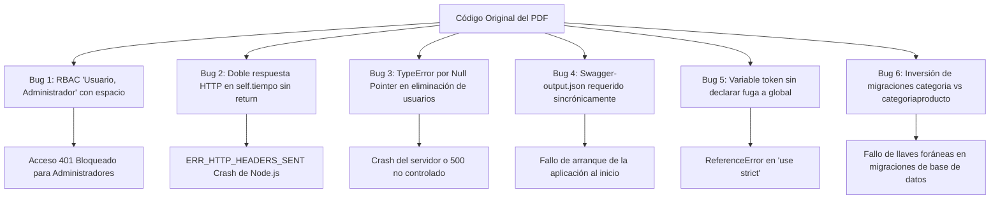

# Reporte de Auditoría Técnica, Arquitectónica y de Seguridad
## Proyecto: E-Commerce Backend API en Node.js (Materia: Programación Segura)

---

### 1. Resumen Ejecutivo y Alcance del Proyecto

El documento analizado corresponde a una **Práctica Guiada** de la *Facultad de Estadística e Informática (Universidad Veracruzana)* orientada al desarrollo de una API REST para un backend de E-Commerce utilizando **Node.js, Express, Sequelize ORM (MySQL), JWT, Multer y Swagger**.

Al tratarse de una materia de **Programación Segura**, la arquitectura debe ser examinada bajo estándares rigurosos de desarrollo seguro (OWASP Top 10 API Security, CWE/SANS Top 25, Principio de Menor Privilegio y Programación Defensiva). 

A continuación se resumen los requerimientos académicos mandatorios y los entregables estipulados para la evaluación en plataforma (Eminus):
1. **Documento Word de entrega:** `NombreAlumno_BackendNode.docx` con portada y capturas de pantalla requeridas.
2. **Evidencias solicitadas:**
   - Capturas del código fuente demostrando las funcionalidades.
   - Captura en VS Code con extensión **REST Client** demostrando consulta `GET` con **3 usuarios nuevos agregados por el estudiante**.
   - Capturas en VS Code ejecutando peticiones `POST`, `PUT` y `DELETE` para gestión de usuarios.
   - Captura de la documentación Swagger generada en el navegador web (`/swagger`).
   - Captura de la consola de MySQL listando tablas y datos creados por el ORM.
   - URL del repositorio público en GitHub (con exclusión estricta de `.env`, `.sql` y archivos sensibles en `.gitignore`).

---

### 2. Discrepancias de Dominio y Defectos Editoriales en el Documento

Una inspección minuciosa del documento revela que la guía fue reciclada o adaptada apresuradamente a partir de una práctica previa orientada a un catálogo de películas/streaming (*"netflixnode"*). Esto dejó inconsistencias críticas en el material:

| Elemento en el Documento | Página / Paso | Inconsistencia Detectada | Impacto / Corrección Requerida |
| :--- | :--- | :--- | :--- |
| **Nombre de Base de Datos** | Pág. 9 vs Pág. 31 | En la pág. 9 se crea `mercadolibrenode`, pero en la captura de consola de la pág. 31 aparece `Tables_in_netflixnode`. | Mantener consistencia con `mercadolibrenode` en `.env` y scripts SQL. |
| **Generación de Modelo Producto** | Pág. 20 (Paso 7) | El comando indica crear `producto`, pero la consola muestra: `npx sequelize model:generate --name pelicula --attributes titulo:string,sinopsis:string,anio:integer,poster:string`. | El modelo debe ser `producto` con atributos `titulo`, `descripcion`, `precio`, `archivoid`. |
| **Captura Swagger** | Pág. 63 (Paso 8) | En la interfaz de Swagger se visualiza el endpoint `/api/peliculas/`. | Corregir y asegurar que documente `/api/productos/`. |
| **Código Faltante en Seeder de Productos** | Pág. 32 (Paso 7) | El recuadro de código para `seed-productos.js` se encuentra **en blanco / truncado** en el PDF. | Se debe construir el seeder completo de productos (15 productos) para coincidir con la tabla asociativa `categoriaproducto`. |
| **Sintaxis de Lenguaje C# en Validaciones** | Pág. 37 | El validador usa `'El campo {0} es obligatorio'`. `{0}` es formato de C#/.NET; `express-validator` no lo interpola automáticamente y lo muestra literal. | Reemplazar por un mensaje limpio en JavaScript: `'El campo nombre es obligatorio'`. |
| **Discrepancia en Rutas de Usuario** | Pág. 2 vs Pág. 47, 58 | La tabla de la pág. 2 define `GET /api/usuarios/{id}`, pero la implementación real en código utiliza `GET /api/usuarios/:email` (el parámetro es el correo). | Estandarizar la API o soportar ambos parámetros de forma segura y consistente. |
| **Discrepancia en Login y Tiempo** | Pág. 2 vs Pág. 55, 59 | La tabla especifica `GET /api/auth` y `GET /api/tiempo`. El código implementa `POST /api/auth` (lo cual es correcto por seguridad) y `GET /api/auth/tiempo`. | Documentar la justificación técnica en el reporte (POST para credenciales sensibles en el cuerpo). |

---

### 3. Matriz de Defectos Críticos de Código y Bugs de Ejecución

El código fuente provisto en la guía contiene fallos lógicos y de ejecución que derriban el servidor o rompen la lógica de negocio y seguridad:



#### Detalle de Hallazgos Críticos:

1. **Bug Crítico de RBAC por falta de `.trim()` (Páginas 56 y 57):**
   - *Código en `auth.middleware.js`:* `rol.split(',').indexOf(decodedToken[ClaimTypes.Role]) == -1`
   - *Código en `categorias.routes.js`:* `Authorize('Usuario, Administrador')`
   - *Fallo:* `'Usuario, Administrador'.split(',')` produce `['Usuario', ' Administrador']`. Cuando un administrador envía su token con rol `"Administrador"`, la comparación con `" Administrador"` (con espacio al inicio) falla siempre (`indexOf` retorna `-1`).
   - *Impacto:* **Todos los usuarios con rol Administrador quedan bloqueados de los endpoints multi-rol**.
   - *Corrección:* `rol.split(',').map(r => r.trim()).indexOf(...)`.

2. **Crash por Doble Cabecera HTTP en `auth.controller.js` (Página 55):**
   - *Código en `self.tiempo`:*
     ```javascript
     if (tiempo == null)
       res.status(404).send()
     res.status(200).send(tiempo)
     ```
   - *Fallo:* Falta la sentencia `return` en la condición `404`. Node.js intenta enviar el estado `200` inmediatamente después de haber enviado el `404`.
   - *Impacto:* **Excepción fatal `ERR_HTTP_HEADERS_SENT: Cannot set headers after they are sent to the client`**, derribando el hilo si no se atrapa.
   - *Corrección:* `if (tiempo == null) return res.status(404).send();`.

3. **Null Pointer Exception y DoS en `usuarios.controller.js` (Páginas 49 y 50):**
   - *Código en `self.delete`:*
     ```javascript
     let data = await usuario.findOne({ where: { email: email } });
     if (data.protegido) return res.status(403).send();
     ```
   - *Fallo:* Si el usuario no existe en la BD, `data` es `null`. La evaluación `data.protegido` arroja de inmediato `TypeError: Cannot read properties of null (reading 'protegido')`.
   - *Impacto:* Peticiones con emails inexistentes lanzan un error 500 y saturan la bitácora en lugar de devolver un `404 Not Found`.
   - *Mismo fallo en `create` y `update`:* Se ejecuta `const rolusuario = await rol.findOne({ where: { nombre: req.body.rol } })` y directamente `rolusuario.id`. Si el cliente envía un rol no existente, la app colapsa por desreferenciación nula.

4. **Variable no declarada `token` (Página 55):**
   - *Código en `auth.controller.js`:* `token = GeneraToken(...)` sin `let` ni `const`.
   - *Impacto:* En entornos con `'use strict'`, arroja `ReferenceError: token is not defined`. En modo sloppy, contamina el objeto global `global.token`, provocando condiciones de carrera entre usuarios concurrentes.

5. **Inversión de Migraciones en el Tutorial (Páginas 20 y 23):**
   - *Pág. 20 (Paso 6):* Muestra el código de creación de la tabla `categoriaproducto` dentro de la explicación de creación de `categoria`.
   - *Pág. 23 (Paso 12):* Muestra el código de creación de `categoria` dentro de la explicación de `categoriaproducto`.
   - *Impacto:* Si se ejecutan en ese orden, la migración falla porque `categoriaproducto` tiene llaves foráneas hacia `categoria` y `producto`, las cuales aún no existirían.
   - *Corrección:* Orden estricto de migraciones: 1) `archivo`, 2) `rol`, 3) `categoria`, 4) `producto`, 5) `categoriaproducto`, 6) `usuario`, 7) `bitacora`.

6. **Error en Clave Foránea de Asociación en `models/archivo.js` (Página 27):**
   - *Código:* `archivo.hasMany(models.producto, { foreignKey: 'id' })`
   - *Fallo:* La clave foránea en la tabla `producto` es `archivoid`, no `id`.
   - *Impacto:* Corrompe los joins automáticos en Sequelize (`include: models.producto`). Debe ser `{ foreignKey: 'archivoid' }`.

7. **Desincronización de Tipos de Datos (UUID vs STRING):**
   - En las migraciones de `rol` y `usuario` (Págs. 24 y 26) se utiliza `Sequelize.UUID`.
   - En las definiciones de modelos (Págs. 24 y 25) se define `DataTypes.STRING`.
   - *Corrección:* Estandarizar a `DataTypes.UUID` y `DataTypes.UUIDV4` tanto en modelos como en migraciones.

8. **Bloqueo al Arranque por `swagger-output.json` Inexistente (Páginas 61 y 62):**
   - `index.js` incluye `const swaggerFile = require('./swagger-output.json')`.
   - *Fallo:* Si un usuario clona el repositorio y ejecuta `npm start` antes de ejecutar `node swagger.js`, la aplicación no puede iniciar por fallo síncrono `MODULE_NOT_FOUND`.
   - *Corrección:* Carga condicional o script de pre-arranque en `package.json` (`"prestart": "node swagger.js"`).

9. **Manejo Incorrecto de Códigos de Estado en Errores de Validación:**
   - En `categorias.controller.js` y `productos.controller.js`:
     ```javascript
     if (!errors.isEmpty()) throw new Error(JSON.stringify(errors));
     ```
   - Al lanzar un `new Error` estándar sin propiedad `statusCode = 400`, el middleware centralizado de errores lo captura y devuelve un código **HTTP 500 (Internal Server Error)** al cliente. Los errores de validación de entrada del cliente **deben ser 400 (Bad Request)**.

---

### 4. Auditoría de Seguridad según Estándares OWASP y CWE

| Vector de Seguridad | Diagnóstico en el PDF | CWE / OWASP | Riesgo | Mitigación Arquitectónica Defensiva |
| :--- | :--- | :--- | :--- | :--- |
| **Carga de Archivos (Uploads)** | Validación basada únicamente en extensión `.jpg` y cabecera HTTP `mimetype`. Sin límite de peso. Nombre original sin sanitizar (`${Date.now()}-${file.originalname}`). | **CWE-434** (Unrestricted Upload), **CWE-22** (Path Traversal), **CWE-400** (DoS) | **ALTO** | 1. Validar *Magic Numbers* (firmas binarias reales del buffer).<br>2. Configurar `limits: { fileSize: 2 * 1024 * 1024 }` (máx 2MB).<br>3. Generar nombres criptográficos aleatorios (`crypto.randomUUID() + '.jpg'`) sin preservar el nombre original. |
| **Asignación Masiva (Mass Assignment)** | Los métodos `update` de categorías, productos y usuarios pasan directamente `req.body` al método `.update()` del ORM. | **CWE-915** (Improperly Controlled Modification of Dynamically-Determined Object Attributes) | **ALTO** | Implementar *Data Transfer Objects* (DTOs) o listas blancas de atributos permitidos (`whitelist: ['titulo', 'descripcion', 'precio']`). Evitar modificación directa de `protegido` o `passwordhash`. |
| **Fuerza Bruta & Credential Stuffing** | El endpoint `POST /api/auth` no cuenta con limitador de peticiones. | **CWE-307** (Improper Restriction of Excessive Authentication Attempts) | **ALTO** | Integrar `express-rate-limit` con ventana estricta (máximo 5 intentos por IP cada 15 minutos en `/api/auth`). |
| **Ataques de Temporización (Timing Attacks)** | En el login, si el usuario no existe retorna de inmediato (0ms), mientras que si existe ejecuta `bcrypt.compare` (~100ms). | **CWE-208** (Observable Timing Discrepancy) | **MEDIO** | Ejecutar una comparación simulada con un hash ficticio si el usuario no existe para mantener el tiempo de respuesta constante y evitar enumeración de usuarios. |
| **Exposición de Tecnologías** | Express envía por defecto la cabecera `X-Powered-By: Express`. Falta de cabeceras de seguridad. | **CWE-693** (Protection Mechanism Failure), **CWE-200** (Information Exposure) | **MEDIO** | Integrar `helmet()` para configurar CSP, HSTS, `X-Content-Type-Options: nosniff`, `X-Frame-Options: DENY`, y remover `X-Powered-By`. |
| **Fallo en CORS para Renovación de Tokens** | `auth.middleware.js` inyecta el nuevo token en `Set-Authorization`. Sin embargo, `cors()` no tiene configurado `exposedHeaders`. | **OWASP API7:2023** (Security Misconfiguration) | **ALTO (Funcional/Seguridad)** | Los navegadores prohíben por política CORS que el frontend acceda a cabeceras personalizadas a menos que el backend envíe `Access-Control-Expose-Headers: Set-Authorization`. Sin esto, la renovación de tokens queda inoperante para clientes web. |
| **Revocación de Sesión JWT** | Los JWT son 100% stateless sin lista de revocación. Si un usuario es eliminado o su rol cambiado, el token sigue vigente 20 minutos. | **CWE-384** (Session Fixation / Invalidation) | **MEDIO** | Establecer un mecanismo de invalidación (en memoria/Redis o validando contra una columna `token_version`/`updatedAt` en el usuario para peticiones críticas). |
| **Condición de Carrera en Operaciones de Negocio** | La asignación de categorías y actualización de productos no usan transacciones Sequelize. | **CWE-362** (Race Condition) | **MEDIO** | Envolver operaciones compuestas en `sequelize.transaction()`. |
| **Seguridad del Sistema de Archivos y Bitácora** | Uso de funciones síncronas (`fs.readFileSync`, `fs.unlinkSync`, `fs.existsSync`). `log/log.txt` falla si la carpeta no existe. | **CWE-703** (Improper Check for Unusual or Exceptional Conditions) | **MEDIO** | Crear directorios necesarios al inicio (`fs.mkdirSync('log', { recursive: true })`), usar `fs.promises` asíncrono para evitar bloquear el Event Loop de Node.js. |

---

### 5. Arquitectura de Carpetas del Proyecto

```
c:\codigo\ps\backendnode\
├── config/
│   ├── config.js               # Conexión Sequelize dinámica con process.env
│   ├── config.json             # Requerido por compatibilidad CLI
│   └── claimtypes.js           # Esquemas URI estándar para claims JWT
├── controllers/
│   ├── archivos.controller.js  # Gestión de archivos en BD y disco
│   ├── auth.controller.js      # Login y tiempo de sesión
│   ├── bitacora.controller.js  # Auditoría de operaciones
│   ├── categorias.controller.js# CRUD de categorías
│   ├── productos.controller.js # CRUD de productos y relación con categorías
│   ├── roles.controller.js     # Catálogo de roles
│   └── usuarios.controller.js  # CRUD de usuarios y hashing
├── docs/
│   ├── reporte_auditoria_backend_node.md # Este reporte técnico completo
│   └── asr_y_justificacion_cambios.md    # ASRs y catálogo de defensa ante el docente
├── middlewares/
│   ├── auth.middleware.js      # Verificación JWT, RBAC y renovación de token
│   ├── bitacora.middleware.js  # Captura de IP y registro en BD
│   ├── errorhandler.middleware.js # Manejo de errores y archivo de log
│   ├── ratelimit.middleware.js # Mitigación de fuerza bruta (Hardening)
│   └── upload.middleware.js    # Multer con validación de tamaño y firmas
├── migrations/
│   ├── 20240101000001-create-archivo.js
│   ├── 20240101000002-create-rol.js
│   ├── 20240101000003-create-categoria.js
│   ├── 20240101000004-create-producto.js
│   ├── 20240101000005-create-categoriaproducto.js
│   ├── 20240101000006-create-usuario.js
│   └── 20240101000007-create-bitacora.js
├── models/
│   ├── index.js                # Loader de Sequelize
│   ├── archivo.js
│   ├── bitacora.js
│   ├── categoria.js
│   ├── producto.js
│   ├── rol.js
│   └── usuario.js
├── restclient/
│   ├── assets/                 # Imágenes de prueba para subida
│   │   ├── producto1.jpg
│   │   └── producto2.jpg
│   ├── archivos.http           # Pruebas REST Client de archivos
│   ├── auth.http               # Pruebas de autenticación y roles
│   ├── categorias.http         # Pruebas de categorías
│   └── usuarios.http           # Pruebas requeridas para la evidencia (3 usuarios)
├── routes/
│   ├── archivos.routes.js
│   ├── auth.routes.js
│   ├── bitacora.routes.js
│   ├── categorias.routes.js
│   ├── productos.routes.js
│   ├── roles.routes.js
│   └── usuarios.routes.js
├── seeders/
│   ├── 20240101000001-seed-categorias.js
│   ├── 20240101000002-seed-productos.js       # Reconstruido con los 15 productos
│   ├── 20240101000003-seed-categoriaproducto.js
│   └── 20240101000004-seed-usuarios.js
├── services/
│   └── jwttoken.service.js     # Generación y cálculo de expiración JWT
├── log/                        # Carpeta persistente para log.txt
├── uploads/                    # Almacén de archivos físicos
├── .env                        # Variables de entorno locales
├── .env.example                # Plantilla pública sin secretos
├── .gitignore                  # Exclusión de node_modules, .env, *.sql, restclient/
├── .sequelizerc                # Configuración de rutas para sequelize-cli
├── bd.sql                      # Script de base de datos
├── index.js                    # Punto de entrada de la aplicación
├── package.json
└── swagger.js                  # Generador de documentación OpenAPI
```
